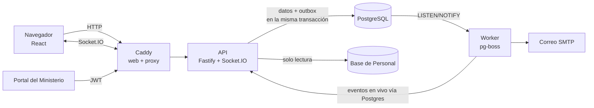

# ECOsoporte

Pedidos de soporte técnico del Ministerio de Ecología y RNR de Misiones: los empleados piden ayuda desde la
computadora o el celular y el equipo de Desarrollo/Soporte la gestiona con tablero kanban, mensajería en
tiempo real, plazos y estadísticas.

## Arranque local

Requisitos: Node 22.12 o posterior y npm. No hace falta Docker ni instalar PostgreSQL.

```bash
npm install
npm run dev
```

Abra <http://localhost:5173>. El primer arranque levanta un PostgreSQL embebido (puerto 5433, datos en
`.data/`), aplica las migraciones y carga datos de demostración. API en el 3000.

### Usuarios de prueba

Contraseña de todos: `Ecologia2024!`. En `/login` hay además accesos rápidos por rol.

| Rol | Correo |
|---|---|
| Administrador | `admin@ecologia.misiones.gob.ar` |
| Técnico | `tecnico@ecologia.misiones.gob.ar` (también `carolina.duarte@`, `diego.ramirez@`) |
| Solicitante | `solicitante@ecologia.misiones.gob.ar` (también `juan.gonzalez@`, `maria.lopez@`) |

Los correos que envía el sistema se ven en <http://localhost:3000/dev/mails>. La API se documenta en
<http://localhost:3000/api/docs>.

## Arquitectura



La API no encola ni emite eventos por su cuenta: cada cambio escribe un evento en `outbox_eventos` en la
misma transacción y el worker lo publica (sockets, notificaciones, correos). Si el worker se detiene, nada se
pierde: se publica al volver. Solo la presencia y «está escribiendo» viajan directo.

| Carpeta | Contenido |
|---|---|
| `packages/shared` | Reglas de dominio (estados, plazos en horas hábiles, permisos), esquemas y contratos |
| `apps/api` | API, autenticación, base de datos (Drizzle) y tiempo real |
| `apps/worker` | Publicación del outbox, correos, alertas de plazo, autocierre y asignación |
| `apps/web` | Interfaz |
| `docker/`, `scripts/`, `tests/` | Despliegue, utilidades y pruebas de punta a punta |

Más detalle: [especificación](docs/SPEC.md), [contrato HTTP](docs/API.md), [decisiones](docs/DECISIONES.md).

## Comandos

| Comando | Qué hace |
|---|---|
| `npm run dev` | Todo el sistema en local |
| `npm test` | Pruebas unitarias y de integración (con Postgres real embebido) |
| `npm run e2e` | Pruebas de punta a punta en un entorno aislado (puertos 5435, 3101 y 5174) |
| `npm run e2e:capturas` · `npm run e2e:perf` | Regenera `docs/capturas/` · mide rendimiento |
| `npm run typecheck` · `npm run lint` · `npm run build` | Tipos, estilo y compilación |
| `npm run db:migrate` · `db:seed` · `db:reset` | Base de datos (`db:reset` **borra los datos**) |
| `npm run dev:token -- --email <correo>` | URL de ingreso como si viniera del portal |
| `npm run backup-db` | Copia de seguridad |

La primera corrida de `npm run e2e` descarga Chromium.

## Variables de entorno

En local no hace falta `.env`. Para desplegar, copie `.env.example`, que explica cada una.

| Variable | Uso | En producción |
|---|---|---|
| `NODE_ENV` | Sin definir se asume `production` (los scripts de desarrollo lo fijan) | |
| `APP_URL` | Dirección con la que se abre el sistema | Obligatoria |
| `POSTGRES_PASSWORD` / `DATABASE_URL` | Base de datos | Obligatoria |
| `SESSION_SECRET`, `ALTCHA_HMAC_KEY` | Firma de sesiones y captcha (32+ caracteres) | Docker las genera si faltan |
| `PORTAL_URL`, `PORTAL_LOGOUT_URL` | A dónde van «Ingresar con el Portal» y el cierre de sesión | Obligatoria |
| `PORTAL_JWT_ALG`, `PORTAL_JWT_SECRET`, `PORTAL_JWT_PUBLIC_KEY`, `PORTAL_JWT_JWKS_URL`, `PORTAL_JWT_ISSUER`, `PORTAL_JWT_AUDIENCE` | Validación del token del portal | Según el portal |
| `PORTAL_API_KEY` | Consulta de existencia de usuarios | Según el portal |
| `PERSONAL_DATABASE_URL` | Base de Personal (solo lectura) | Recomendada |
| `SMTP_HOST`, `SMTP_PORT`, `SMTP_SECURE`, `SMTP_USER`, `SMTP_PASSWORD`, `MAIL_FROM` | Correo | Sin SMTP no se envía |
| `SEED_DEMO` | Datos y cuentas de demostración | No definir |
| `ADMIN_EMAIL`, `ADMIN_PASSWORD` | Administrador inicial | Correo obligatorio |
| `ADJUNTOS_PERMITIDOS` | Extensiones admitidas (vacío = todas las verificables) | Opcional |
| `COOKIE_SECURE`, `TRUST_PROXY`, `HSTS`, `CADDY_TRUSTED_PROXIES` | HTTPS y proxy | Ver operación |
| `LOG_LEVEL`, `LOGIN_MAX_INTENTOS`, `ALTCHA_COSTO` | Ajustes | Opcional |
| `APP_PORT`, `METABASE_*`, `DATA_DIR`, `UPLOADS_DIR`, `PG_PORT` | Puertos y carpetas | Opcional |

## Ingreso desde el portal del Ministerio

El portal autentica a la persona y la envía con un JWT:

- `GET /auth/portal?token=<JWT>&redirect=/mis-pedidos`
- `POST /auth/portal` con `token` en el cuerpo (JSON o formulario), recomendado: el token no queda en la URL.
- `Authorization: Bearer <JWT>`

| Claim | | |
|---|---|---|
| `email` | obligatorio | Identifica a la persona (sin distinguir mayúsculas) |
| `exp` | obligatorio | Vencimiento. Tolerancia de reloj: 30 s |
| `iss` | obligatorio | Igual a `PORTAL_JWT_ISSUER` |
| `aud` | si se define `PORTAL_JWT_AUDIENCE` (recomendado) | |
| `jti` | opcional | Si viene, el token sirve una sola vez |
| `nombre`, `sub` | opcionales | Otros claims se ignoran |

Firma `HS256` (secreto compartido) o `RS256` (clave pública o JWKS). El token del portal no se usa como sesión
ni se guarda: ECOsoporte abre una sesión propia y quita el token de la dirección. Para cambiar nombres de
claims hay un solo lugar: `apps/api/src/auth/mapear-claims.ts`.

Quien está en Personal y entra por primera vez se crea como solicitante. Quien no figura ve «Su usuario no
está habilitado».

### Botonera del portal

```
GET /api/sso/usuario-existe?email=persona@ecologia.misiones.gob.ar
X-Portal-Key: <PORTAL_API_KEY>
→ { "existe": true, "rol": "solicitante" }
```

### Ingreso de respaldo

`/login` admite correo y contraseña (argon2id) con verificación ALTCHA propia y recupero por correo.

## Base de Personal

Con `PERSONAL_DATABASE_URL` se consulta en cada ingreso, siempre en modo de solo lectura, para actualizar
nombre, área y estado; quien figura inactivo queda bloqueado. **Los nombres de la tabla y de las columnas se
ajustan en un único archivo: `apps/api/src/auth/personal/tabla.ts`.** Use un usuario de base de datos que solo
pueda leer esa tabla. Sin esta variable, en producción solo ingresan los usuarios cargados en ECOsoporte.

## Despliegue, backups y restauración

```bash
cp .env.example .env     # complete lo marcado [OBLIGATORIO]
docker compose up -d --build
docker compose exec api cat /data/secretos/admin-inicial   # contraseña del administrador
```

> El despliegue con Docker **no se probó en contenedores**. Verifique el primer arranque en el servidor.

Guía completa, Metabase, backups y restauración: [docs/OPERACION.md](docs/OPERACION.md).

## Pruebas y rendimiento

Dominio (estados, plazos, permisos) con pruebas unitarias; API, base, colas y sockets con integración sobre un
Postgres real; los flujos principales, el aislamiento entre usuarios y la accesibilidad con Playwright.
Mediciones y limitaciones: [docs/PERFORMANCE.md](docs/PERFORMANCE.md). Pantallas: [docs/capturas](docs/capturas).
